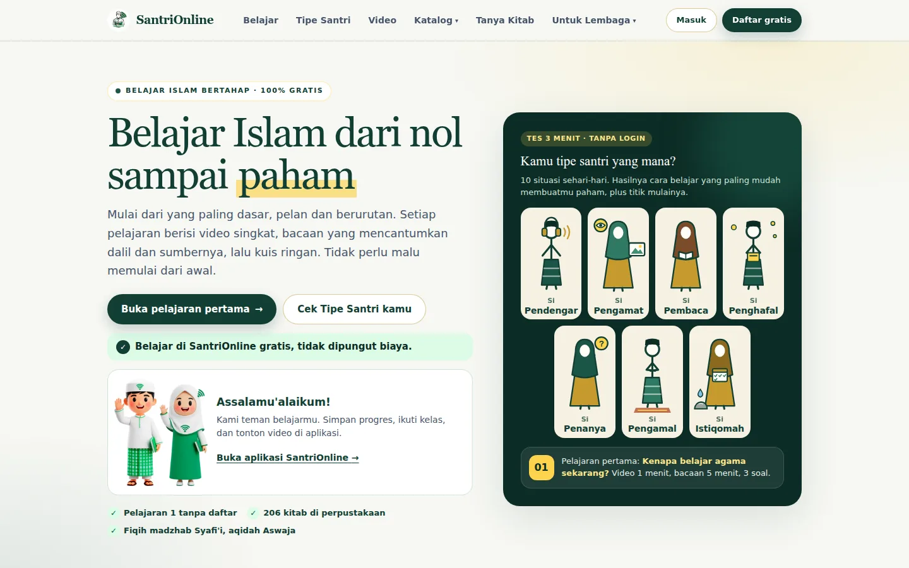

<div align="center">

<a href="https://santrionline.com">
  
</a>

# SantriOnline

**Belajar Islam dari nol sampai paham — bertahap, berdalil, gratis.**

*Learn Islam step by step, from zero — with references, for free. Built for Indonesian Muslims.*

[](https://santrionline.com)
[](https://app.santrionline.com)


[**Buka situs**](https://santrionline.com) ·
[**Pelajaran pertama**](https://santrionline.com/belajar) ·
[**Tes Tipe Santri**](https://santrionline.com/tipe-santri) ·
[**Aplikasi lembaga**](https://santrionline.com/lembaga) ·
[**Kontak**](https://santrionline.com/kontak)

<br>


&nbsp;


</div>

---

## ✨ Tentang

SantriOnline adalah **sistem pembinaan generasi muslim**: membentuk anak muda yang beraqidah kuat, beradab, menjadikan ibadah kebiasaan, dan punya skill untuk dunia nyata — bukan sekadar kumpulan materi.

Repo ini adalah **santrionline.com** — pintu masuk publik untuk belajar Islam bertahap, etalase katalog kitab & buku, dan halaman untuk lembaga. Akun, progres belajar, toko digital, dan aplikasi lembaga ada di **[app.santrionline.com](https://app.santrionline.com)**.

> **Arah keilmuan:** Ahlus Sunnah wal Jama'ah, fiqih madzhab Syafi'i. Materi agama tayang setelah diperiksa; setiap bacaan mencantumkan dalil dan sumbernya.

## 🧩 Fitur

| | Fitur | Keterangan |
|---|---|---|
| 🧭 | **Tes Tipe Santri** | 10 situasi sehari-hari, ±3 menit, tanpa login → 7 cara belajar (pendengar, pengamat, pembaca, penghafal, penanya, pengamal, istiqomah). |
| 📖 | **Belajar bertahap** | Tiap pelajaran: video singkat, bacaan berdalil, kuis ringan. Pelajaran pertama tanpa daftar. |
| 📚 | **Katalog kitab & buku** | Perpustakaan yang sinkron otomatis dengan aplikasi, halaman detail ramah SEO. |
| 🤖 | **Cari Isi Kitab** | Jawaban yang menunjuk halaman kitab di perpustakaan, dengan bank pertanyaan siap dan pencarian pertanyaan mirip. |
| 🎬 | **Video** | Video pembelajaran pendek yang diputar langsung di situs. |
| 🏫 | **Untuk lembaga** | Aplikasi gratis untuk pondok pesantren, TPQ, dan rumah tahfidz: data santri, hafalan, rapor, keuangan. |
| 🔎 | **SEO** | Meta & Open Graph per halaman, gambar OG relevan, `sitemap.xml`, semuanya dijaga lewat tes SEO otomatis. |

## 🛠️ Teknologi

- **[SvelteKit 2](https://svelte.dev/docs/kit)** + **Svelte 5** (runes) + **TypeScript**
- **[Tailwind CSS 4](https://tailwindcss.com)** (konfigurasi CSS-first lewat `@theme`)
- Berjalan di edge (adapter Cloudflare, build Pages) dengan data katalog yang dibagi bersama aplikasi utama
- Tes memakai `node --test` bawaan — tanpa framework tambahan

## 🚀 Mulai mengembangkan

```bash
git clone https://github.com/Santrionlinecom/web.git
cd web
npm install
npm run dev          # http://localhost:5173
```

| Perintah | Fungsi |
|---|---|
| `npm run dev` | Server pengembangan dengan hot reload |
| `npm run check` | Cek tipe binding, sinkronisasi SvelteKit, dan `svelte-check` |
| `npm test` | Menjalankan seluruh tes di `tests/` |
| `npm run build` | Build produksi |
| `npm run preview` | Pratinjau hasil build secara lokal |

> Beberapa fitur (katalog, Cari Isi Kitab) membutuhkan binding data produksi; tanpa itu halaman tetap tampil dengan data kosong.

## 🗂️ Struktur proyek

```text
src/
├── routes/
│   ├── belajar/          # jalur belajar bertahap per modul
│   ├── tipe-santri/      # tes 7 cara belajar
│   ├── katalog/          # katalog kitab & buku + detail
│   ├── video/            # video pembelajaran
│   ├── lembaga/          # aplikasi untuk pesantren, TPQ, rumah tahfidz
│   ├── literasi/         # artikel pengantar (tahfidz, munaqosah, dll.)
│   ├── api/              # chat Cari Isi Kitab, rating, webhook
│   └── sitemap.xml/      # sitemap dinamis
├── lib/
│   ├── components/       # komponen UI
│   ├── belajar/          # data pelajaran
│   └── server/           # katalog, pertanyaan siap, statistik
static/                   # logo, ikon, gambar katalog
tests/                    # tes SEO, salinan publik, Cari Isi Kitab, video, dll.
docs/                     # catatan desain & audit
```

## 🤲 Prinsip konten

1. **Berdalil** — setiap bacaan mencantumkan ayat, hadits (kitab dan nomornya), atau rujukan kitab.
2. **Bertahap** — mulai dari yang paling dasar; tidak ada yang perlu malu memulai.
3. **Disahkan dulu** — konten agama tayang setelah diperiksa.
4. **Beradab** — tidak menggambar Nabi ﷺ, sahabat, atau ulama bernama; bahasa menyejukkan, tanpa provokasi.
5. **Gratis untuk belajar** — belajar di SantriOnline tidak dipungut biaya.

## 🤝 Kontribusi

Masukan sangat kami hargai — koreksi materi, laporan bug, maupun ide fitur.

- **Koreksi materi agama:** buka [issue](https://github.com/Santrionlinecom/web/issues) dengan menyebut halaman dan rujukannya.
- **Bug / ide:** buka issue dengan langkah reproduksi atau tangkapan layar.
- **Pull request:** buat dari branch baru; pastikan `npm run check` dan `npm test` lulus.

## 📬 Kontak

- 🌐 [santrionline.com](https://santrionline.com) · 📱 [app.santrionline.com](https://app.santrionline.com)
- ✉️ masyogik@santrionline.com
- 📍 Pendem, Junrejo, Kota Batu, Jawa Timur, Indonesia

<div align="center">

<br>

**Dibangun dengan niat menebar ilmu yang bermanfaat.**
<br>
<sub>© 2026 SantriOnline · Yogik Pratama Aprilian. Semua hak dilindungi.</sub>

</div>
